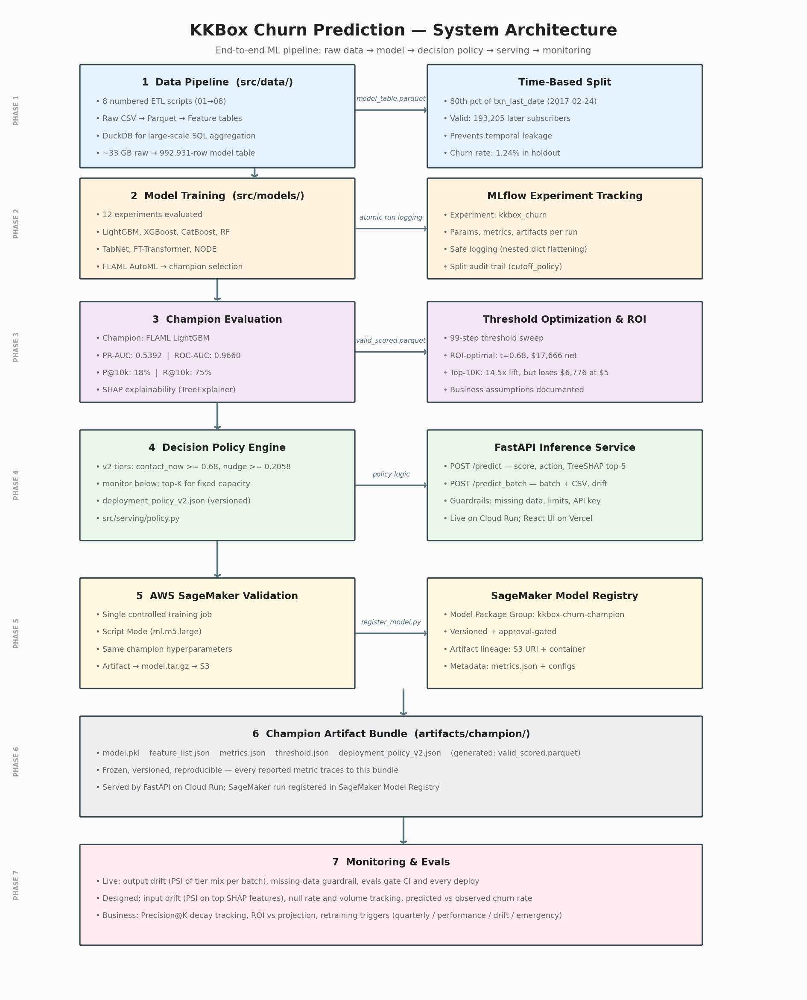

# AI Customer Retention & Decision Intelligence Platform


> End-to-end ML platform built on **~33 GB of real KKBox subscription data** — from raw logs to a production-grade decision policy. Predicts subscriber churn, optimizes intervention targeting, and simulates measurable business ROI.

This project goes beyond model accuracy. It demonstrates full-stack ML system design: scalable feature engineering, experiment governance, a versioned tiered decision policy, and ROI-aligned threshold optimization — mirroring real MLE + MLOps + AI Product workflows.

**Live:** [Decision Intelligence UI](https://churn.ameyparmarthi.com/) (React: per-customer model attributions, suggested actions, one-click executive summary) · [Streamlit dashboard](https://amey-churn-predictor.streamlit.app/) · [API on Cloud Run](https://churn-api-995576020018.us-central1.run.app/docs)

**Product and delivery docs:** [PRD](docs/PRD.md) · [Decision log](docs/decisions.md) · [Customer deployment playbook](docs/customer-deployment-playbook.md) · [Evals](evals/README.md)

---

## Results at a Glance

| Metric | Value | Lift |
|---|---:|---:|
| ROC-AUC (time-based holdout) | **0.9660** | **1.9x** vs random (0.50) |
| PR-AUC | **0.5392** | **43.4x** vs base rate (1.24% holdout) |
| Precision @ top-10k contacts | **18.0%** | **14.5x** vs holdout churn rate |
| Recall @ top-10k contacts | **75.0%** | — |
| ROI-optimal threshold (API default), simulated net value | **$17,666** per cycle (1,478 contacts, net ROI 239%) | — |
| Tiered top-10k ($5 incentive for top 1,478, $0.50 nudge for the rest), simulated net value | **$24,306** per cycle | — |

Dollar figures are simulated on the 193,205-subscriber validation window under documented assumptions ($120 per save, $5 per contact, 20% save rate), not realised revenue.

### Scaling: 33 GB to Production

The full ~33 GB KKBox dataset is processed end-to-end — not sampled, not approximated. Every scaling decision is documented with trade-offs and a web-scale migration path.

| Stage | Size | Tool | Why |
|---|---:|---|---|
| Raw CSVs | 32.7 GB | DuckDB streaming | pandas would OOM on the 30.5 GB `user_logs.csv` |
| Parquet (ZSTD) | 10.7 GB | DuckDB + column pruning | 3.1x compression; read only the columns you need |
| Aggregated features | 534 MB | DuckDB 2-stage SQL | 394 MB log + 140 MB transaction features via daily pre-aggregation |
| ML-ready table | 123 MB | pandas joins | 992,931 rows; small enough post-agg that the pandas ecosystem wins |
| Champion model training | ~3 min | LightGBM + FLAML | Best PR-AUC across 12 experiments; 8-11x faster than FT-Transformer and TabNet |

> **Deep dive:** [`notebooks/08_scaling_prototype.ipynb`](notebooks/08_scaling_prototype.ipynb) — full trade-off analysis, DuckDB vs Spark rationale, and architecture blueprint for scaling to billions of rows.

---

## Table of Contents

1. [Problem & Business Goal](#1-problem--business-goal)
2. [Data & Split Strategy](#2-data--split-strategy)
3. [Model Benchmarking Results](#3-model-benchmarking-results)
4. [Champion Model & Why It Won](#4-champion-model--why-it-won)
5. [Decision Policy & ROI Simulation](#5-decision-policy--roi-simulation)
6. [Explainability & Product Insights](#6-explainability--product-insights)
7. [Serving: FastAPI Inference API](#7-serving-fastapi-inference-api)
8. [Experiment Tracking: MLflow](#8-experiment-tracking-mlflow)
9. [Cloud Validation: AWS SageMaker](#9-cloud-validation-aws-sagemaker)
10. [Scaling: Prototype to Production](#10-scaling-prototype-to-production)
11. [Monitoring Plan](#11-monitoring-plan)
12. [Tech Stack](#12-tech-stack)
13. [Repository Structure](#13-repository-structure)
14. [Quick Start](#14-quick-start)
15. [Project Status & Next Steps](#15-project-status--next-steps)
16. [What This Demonstrates](#16-what-this-demonstrates)

---

## 1. Problem & Business Goal

Every subscription business faces the same three questions:

| Question | This System's Answer |
|---|---|
| **Who is likely to churn?** | Ranked churn probability score for every subscriber |
| **Who should we target, given budget constraints?** | ROI-optimal threshold by default; top-K when contact capacity is fixed |
| **What is the expected financial impact?** | Simulated net value under configurable cost assumptions |

**Core design principle:** *Model probability → Decision policy → Financial outcome.*

Traditional ML projects optimize ROC-AUC. This system optimizes **business ROI**.

---

## 2. Data & Split Strategy

**Source:** [KKBox Churn Prediction Challenge (Kaggle)](https://www.kaggle.com/competitions/kkbox-churn-prediction-challenge)

### 2.1 Dataset Overview

| Property | Value |
|---|---:|
| Raw size | 32.7 GB (CSV) |
| Processed model table | 992,931 rows, 38 model features |
| Validation set | 193,205 rows |
| Churn rate (full model table) | 6.4% |
| Churn rate (time-based valid) | 1.24% (2,402 churners) |
| Time range | Jan 2015 – Feb 2017 |
| Holdout window | Latest 20% by `txn_last_date` (after 2017-02-24) |

Large raw files are excluded from Git. The champion bundle (`model.pkl`, `threshold.json`, `feature_list.json`, `metrics.json`) is committed; the scored validation set (`valid_scored.parquet`), `flaml_best_params.json` and the threshold sweep CSV are regenerated by the training and scoring scripts and gitignored. The FLAML parameters are also recorded in `reports/champion_metadata.json`.

### 2.2 Why Time-Based Split

The champion evaluation uses a **chronological holdout**: rows are split at the 80th percentile of `txn_last_date` (resolves to 2017-02-24). Train on subscribers whose last transaction is on or before the cutoff, validate on the 193,205 whose last transaction is later. This simulates production: the model trains on history and scores a later period it has never seen.

> **Note:** the training script parses `YYYYMMDD` integers without a format string, so `metrics.json` stores the cutoff as `1970-01-01 00:00:00.020170224`. Order is preserved, so the split is still chronological; the label is cosmetic. The SageMaker run (Section 9) uses a fixed 2017-01-31 cutoff instead.

| | Random Split (XGBoost) | Time-Based Holdout (Champion) | Champion Lift |
|---|---:|---:|---:|
| ROC-AUC | 0.9875 | **0.9660** | **1.9x** vs random (0.50) |
| PR-AUC | 0.8771 | **0.5392** | **43.4x** vs base rate (1.24%) |

Lower time-based numbers are more honest — random splits leak temporal patterns and inflate all metrics. The 6.4% overall churn rate drops to 1.24% in the time-based holdout, which is expected with time-based splits and exactly what makes evaluation realistic.

### 2.3 Data Pipeline

Eight numbered, independently runnable scripts — no notebook dependencies:

| Script | Purpose |
|---|---|
| `01_convert_to_parquet.py` | Convert raw CSVs to columnar Parquet for fast I/O |
| `02_build_spine.py` | Create user-month observation spine (label join anchor) |
| `03_aggregate_transactions.py` | Transaction-level behavioral rollups per user |
| `04_aggregate_user_logs.py` | Activity log aggregations (listening behavior, etc.) |
| `05_build_model_table.py` | Join all feature tables into the ML-ready model table |
| `06_create_sample_data.py` | Lightweight extracts for dev / CI testing |
| `07_create_derived_tables.py` | Derived feature tables (recency, tenure, frequency) |
| `08_data_subset_for_sagemaker.py` | Create cost-controlled subset for SageMaker training |

**Key engineering decisions:**
- Strict chronological ordering prevents future-signal leakage
- Memory-aware processing for ~33 GB of raw files
- DuckDB used for large-scale in-process SQL aggregation
- All transformations are scriptable and reproducible

### 2.4 System Architecture



*Regenerate: `python scripts/generate_architecture_diagram.py`*

---

## 3. Model Benchmarking Results

12 experiments: majority and logistic-regression baselines, a decision tree, seven model families, a soft-vote ensemble and FLAML AutoML. The seven model families are below; full details in [`leaderboard.md`](leaderboard.md).

Sorted by PR-AUC — the primary metric under class imbalance:

| # | Model | PR-AUC | PR-AUC Lift | ROC-AUC | F1 | Train Time | Notes |
|---:|---|---:|---:|---:|---:|---:|---|
| 1 | LightGBM | 0.8887 | **13.9x** | 0.9894 | 0.7845 | ~3 min | Baseline config, scale_pos_weight |
| 2 | XGBoost | 0.8771 | **13.7x** | 0.9875 | — | ~2 min | Baseline XGBoost |
| 3 | CatBoost | 0.8737 | **13.7x** | 0.9865 | 0.7282 | ~3.7 min | GPU-accelerated, early stop |
| 4 | FT-Transformer | 0.8214 | **12.9x** | 0.9824 | 0.6825 | ~23 min | 4-layer transformer, AMP, GPU |
| 5 | Random Forest | 0.7935 | **12.4x** | 0.9782 | 0.5798 | ~5 min | One-hot, balanced_subsample |
| 6 | NODE | 0.7719 | **12.1x** | 0.9737 | 0.5334 | ~11 min | 128 oblivious trees, GPU |
| 7 | TabNet | 0.5233 | **8.2x** | 0.9085 | 0.3998 | ~32 min | 5 failed runs before convergence |

> Leaderboard metrics use random splits for comparison speed; lift is PR-AUC over the 6.39% random-split churn rate. **Champion evaluation uses the time-based holdout** — the only number that matters for production.

### 3.1 Class Imbalance Strategy

- Class weighting at training time (`scale_pos_weight`)
- PR-AUC as the primary evaluation metric (not ROC-AUC, not accuracy)
- Precision@K for business-facing evaluation
- Full 99-step threshold sweep to find the ROI-aligned decision boundary

### 3.2 Why PR-AUC Over ROC-AUC

ROC-AUC can appear high (~0.96+) even when the model performs poorly on the minority class, because it credits correct majority-class predictions equally. With a 1.2% churn rate in the time-based holdout, ROC-AUC overstates discriminative power.

PR-AUC directly measures how well the model concentrates true churners at the top of the ranked list — which is exactly what the business needs for targeted intervention. A model with 0.96 ROC-AUC but 0.40 PR-AUC is a model that looks great on paper but wastes outreach budget.

---

## 4. Champion Model & Why It Won

**FLAML AutoML — LightGBM** | MLflow experiment: `kkbox_churn` | Run: `champion_lgbm_time_holdout`

### 4.1 Champion Metrics (time-based holdout)

| Metric | Value | Lift |
|---|---:|---:|
| ROC-AUC | 0.9660 | **1.9x** vs random (0.50) |
| PR-AUC | **0.5392** | **43.4x** vs base rate (1.24%) |
| F1 @ threshold 0.5 | 0.3678 | — |
| Precision @ top-5k | 26.9% | **21.6x** vs base rate |
| Precision @ top-10k | **18.0%** | **14.5x** vs base rate |
| Precision @ top-20k | 10.9% | **8.8x** vs base rate |
| Recall @ top-5k | 56.0% | — |
| Recall @ top-10k | **75.0%** | — |
| Recall @ top-20k | 90.7% | — |

**Churn concentration lift:** on the time-based holdout (1.24% churn), the top-10k contacts churn at 18.0%, a **14.5x concentration** over random selection, and capture 75% of all churners. PR-AUC lift is **43.4x** over random.

### 4.2 Why This Model Won

1. **Highest PR-AUC on the time-based holdout (0.5392)** — PR-AUC directly measures ranking quality under severe class imbalance (1.24% validation churn rate)
2. **Architecture dominance confirmed twice** — LightGBM ranked #1 in the random-split leaderboard (0.8887 PR-AUC), and FLAML's AutoML search independently converged on LightGBM as the best estimator
3. **Broader hyperparameter search** — FLAML explored configurations manual tuning missed (e.g., `num_leaves=1212` vs. manual `64`, `reg_alpha=0.56`), producing better generalization to the harder time-based split
4. **Training efficiency** — LightGBM trains in ~3 minutes vs. 23-32 minutes for deep learning alternatives (FT-Transformer, TabNet) that scored worse on every metric

Artifacts frozen in `artifacts/champion/` — see [`artifacts/champion/notes.md`](artifacts/champion/notes.md) for the reproducibility checklist.

---

## 5. Decision Policy & ROI Simulation

### 5.1 Decision Policy Engine

`artifacts/champion/deployment_policy_v2.json` defines three score tiers. `src/serving/policy.py` applies them and `src/serving/api.py` returns the tier as `action` with every score:

| Action | Score | Channel | Validation contacts (churners) |
|---|---|---|---:|
| `contact_now` | ≥ 0.68 (ROI-max cutoff) | Personal outreach, $5 incentive, 20% assumed save rate | 1,478 (1,044) |
| `nudge` | 0.2058–0.68 (down to the 10,000th rank) | Email or in-app, $0.50, 12% illustrative save rate | 8,522 (757) |
| `monitor` | < 0.2058 | None; re-score next cycle | 183,205 (601) |

Three ways to spend the same scores:

| Policy | Rule | Contacts | Precision | Recall | Simulated net / cycle |
|---|---|---:|---:|---:|---:|
| **ROI-optimal threshold** *(API default `churn_label`)* | score ≥ 0.68 | 1,478 | 70.6% | 43.5% | **$17,666** |
| Capacity top-K, one channel | top 10,000 (≈ score ≥ 0.2058) | 10,000 | 18.0% | 75.0% | **−$6,776** |
| **Tiered (policy v2)** | `contact_now` + `nudge` | 10,000 | 18.0% | 75.0% | **$24,306** |

At the default assumptions ($120 per save, $5 per contact, 20% save rate), giving the $5 incentive to all 10,000 loses money: below the top 1,478, precision is too low to cover the contact cost. That finding is why v2 replaced v1 (`deployment_policy.json`, top-K primary), which is kept for the record. The nudge cost and save rate are illustrative until a holdout measures them ([decision log](docs/decisions.md)).

`/predict_batch?policy=top_k&k=...` still ranks a batch for teams that work a fixed-size call list:
- Contact volume is predictable and budget-bounded every cycle
- No threshold recalibration needed as score distributions shift over time
- Simple governance: rank and send

### 5.2 ROI Simulation

#### Framework

```
Net value = (TP x save_rate x value_per_save) - (N_targeted x cost_per_contact)
Net ROI   = Net value / (N_targeted x cost_per_contact)

Where:
  TP               = true positives (targeted users who would have churned)
  save_rate        = fraction of targeted churners successfully retained
  value_per_save   = revenue retained per saved churner
  cost_per_contact = cost per outreach contact
```

At the ROI-optimal threshold: value retained $25,056, spend $7,390, net $17,666, net ROI 239% ($3.39 retained per $1 spent). Break-even save rate 5.9%; break-even contact cost $16.95.

#### Scenario Comparison

| Scenario | Cost/contact | Save rate | Value/save | Contacts | Net result |
|---|---:|---:|---:|---:|---:|
| **ROI-optimal threshold** | $5.00 | 20% | $120 | 1,478 | **$17,666** |
| **Outreach** (email/SMS/nudge) | $0.50 | 12% | $80 | 10,000 | **$12,290** |
| **Incentive** (discount/offer) | $10.00 | 20% | $60 | any | Loses money unless precision > 83% |

Full scenario documentation: [`reports/business_assumptions.md`](reports/business_assumptions.md)

#### Threshold Sweep Outputs

`src/evaluation/threshold_optimization.py` sweeps 99 thresholds and produces:

| Output | Description |
|---|---|
| `reports/threshold_sweep.csv` | Per-threshold: precision, recall, F1, Precision@K, ROI, n_targeted (generated, gitignored) |
| `artifacts/champion/threshold.json` | Selected policy parameters (both policies) |
| `reports/threshold_vs_precision_recall.png` | Precision / Recall / F1 vs. threshold |
| `reports/threshold_vs_roi.png` | Expected ROI vs. threshold with annotated peak |

---

## 6. Explainability & Product Insights

To move beyond black-box prediction, the champion LightGBM model is analyzed with **SHAP** (SHapley Additive exPlanations) — making predictions auditable for engineers and actionable for product teams.

### 6.1 SHAP Analysis

SHAP decomposes each individual prediction into additive feature contributions:

```
churn_probability  =  base_rate
                    + Σ (per-feature SHAP contributions)
```

Every feature either increases or decreases a user's churn risk relative to the population average — making each score fully explainable.

**What SHAP enables:**
- Identify the strongest global churn drivers across the model
- Separate risk-increasing signals from protective ones
- Detect when the model is learning noise vs. real behavioral patterns
- Segment users into actionable behavioral cohorts

**Outputs** — computed on a 20,000-row validation sample via `shap.TreeExplainer`:

```bash
python -m src.evaluation.shap_analysis
```

| Output | Description |
|---|---|
| `reports/shap_summary.png` | Beeswarm plot — feature importance + direction across all users |
| `reports/top_features.csv` | Ranked feature list with mean absolute SHAP values |

### 6.2 Top Churn Drivers

| Rank | Feature | Mean \|SHAP\| | Business Signal |
|---:|---|---:|---|
| 1 | `auto_renew_rate` | 0.593 | Auto-renewal opt-in rate — the single strongest churn predictor; users not opting in are signaling exit intent |
| 2 | `cancel_rate` | 0.499 | Historical cancellation ratio — past behavior is a very strong fingerprint for future churn |
| 3 | `plan_list_price_max` | 0.329 | Peak plan price seen — captures price sensitivity and premium-tier exposure |
| 4 | `log_last_date` | 0.281 | Recency of last activity — disengagement precursor; a leading indicator before cancellation |
| 5 | `membership_expire_date_max` | 0.247 | Subscription horizon — proximity to expiry concentrates churn risk |

### 6.3 Model-Derived Risk Signals

SHAP confirms that the model has learned interpretable, causally-plausible churn signals — not spurious correlations:

| Risk Signal | Key Feature | Business Interpretation |
|---|---|---|
| Auto-renewal opt-out pattern | `auto_renew_rate` | Strongest signal — low auto-renewal rate directly reflects disengagement or intent to cancel |
| Historical cancellation behavior | `cancel_rate` | Past cancellations strongly predict future churn; the model learned this behavioral fingerprint |
| Declining recent activity | `log_last_date` | Recency of last activity is a leading indicator — disengagement precedes cancellation |
| Imminent subscription expiry | `membership_expire_date_max` | Expiry proximity concentrates churn risk — intervention window is narrow |
| Short tenure | `txn_tenure_days_approx` | Early lifecycle churn — product fit or onboarding issue |

### 6.4 Translating Risk Into Action

Model scores and SHAP cohort signals together enable targeted retention strategies:

| Intervention | Channel | When to Use |
|---|---|---|
| Proactive outreach | Email / SMS / in-app push | Default for all top-K users |
| Renewal reminder | Email / push notification | Users within 7–14 days of expiry |
| Payment resolution | Support + email | Users with recent payment failures |
| Friction reduction | UX / product flow | Users dropping off at renewal step |
| Human-assisted retention | Support team | High-LTV users in top decile of risk |

### 6.5 Experimental Validation *(AI Product Lens)*

Churn models predict *who will churn* — not *who will respond to intervention*. Without a control group, measured ROI conflates natural churn with model-driven saves. The correct validation approach:

1. Score all subscribers monthly
2. Select the top-K highest-risk users
3. Randomly split into: **50% Treatment** (retention campaign) / **50% Control** (no contact)
4. Measure churn rate difference between groups after 30 days

This isolates true incremental lift:

```
True incremental ROI  =  (churn_rate_control − churn_rate_treatment)
                       × N_treatment
                       × LTV
                       − intervention_cost
```

This is the correct metric — it separates predictive correlation from **causal retention uplift**.

---

## 7. Serving: FastAPI Inference API

Production-ready REST API at `src/serving/api.py` — wraps the champion model and exposes both decision policies over HTTP. Built with FastAPI and Pydantic; all artifacts are loaded at startup from `artifacts/champion/`.

```bash
uvicorn src.serving.api:app --reload
# Swagger UI: http://localhost:8000/docs
```

### 7.1 Endpoints

| Endpoint | Method | Description |
|---|---|---|
| `/` | GET | Service info and the 38-feature input contract |
| `/health` | GET | Model load status, artifact paths, feature count, default threshold, policy version |
| `/predict` | POST | Single-record churn probability, threshold label, policy `action`, top-5 TreeSHAP attributions, missing-data warnings |
| `/predict_batch` | POST | Batch scoring via JSON list or CSV file upload (≤ 50,000 records) — threshold or top-K policy, plus output drift |

### 7.2 Two Serving Policies

**Threshold policy** (single record or batch):
```json
POST /predict
{ "record": { ...feature dict... }, "policy": "threshold", "threshold": 0.68 }
```

**Top-K policy** (batch only — ranking requires population context):
```json
POST /predict_batch
{ "records": [...], "policy": "top_k", "k": 10000 }
```

Returns per-record: `churn_probability`, `churn_label`, `action`, `rank` (top-K only), `policy_used`, `threshold_used`. `/predict` adds `explanations`, `base_value`, `n_missing_features` and `warnings`; batch responses add `n_mostly_missing` and `score_drift`.

**CSV batch upload** is also supported via multipart form upload to `/predict_batch` — enabling analyst-driven batch scoring without a pipeline dependency.

### 7.3 Design Notes

- Pydantic input/output models enforce contract at the API boundary — `PredictRequest`, `BatchPredictRequest`, `BatchPredictResponse`
- Feature alignment at inference time: missing columns filled with `NaN`, extra columns dropped. The model reads missing activity as churn (an empty record scores 0.99), so `/predict` warns when more than half the features are missing and batches report `n_mostly_missing`
- Guardrails: `threshold` must be in [0, 1] (422), batches over 50,000 records return 413, and setting the `API_KEY` env var requires an `X-API-Key` header on the POST endpoints (`/health` stays open for probes). The public demo runs without a key
- Output drift without labels: batches of ≥ 1,000 records return `score_drift`, the PSI of the batch's tier mix against validation (< 0.1 stable, < 0.25 moderate, else significant)
- Equivalent threshold for the configured top-K is surfaced in the response when it matches `threshold.json`, giving every top-K batch run a threshold anchor for auditability

### 7.4 Decision Intelligence UI (`frontend/`)

A React + Vite + TypeScript front end for executives and retention operators, live at **https://churn.ameyparmarthi.com/**. It calls this API and falls back to a clearly labelled Demo Mode while Cloud Run cold-starts. Details: [frontend/README.md](frontend/README.md) · design notes: [docs/frontend-architecture.md](docs/frontend-architecture.md) · walkthrough: [docs/demo-script.md](docs/demo-script.md).

- **Why this score:** with the live API, each scored customer shows the model's top-5 TreeSHAP attributions in probability points, labelled as model attributions, and any missing-data warning. In Demo Mode, and in the batch top-reasons column, the drivers are **indicative, from a transparent rule of thumb, not the model's attributions**, and the UI says so. Each score also gets the suggested action for its tier: personal outreach with an incentive at ≥ 0.68, a low-cost email or in-app nudge at 0.2058–0.68, otherwise monitor.
- **One-click executive summary:** the policy simulator turns the current scenario into a one-page report covering the recommendation, key numbers, a contact plan by risk band at your subscriber count, assumptions, risks and caveats. It prints to PDF or downloads as Markdown. Dollar figures are simulated on the 193,205-subscriber validation window and scaled to your base, not realised revenue.
- **Batch CSV export** columns: `row_index, rank, churn_probability, label_at_0_68, in_top_k, risk_band, suggested_action, top_reasons, <input columns>`. The last three named columns are new ([CHANGELOG](CHANGELOG.md)).

### 7.5 Model Explanations in the API

`/predict` returns the top 5 per-record TreeSHAP contributions from the champion via `MODEL.predict(X, pred_contrib=True)` on the existing `LGBMClassifier`: exact log-odds contributions plus a bias term (`base_value`), with no `shap` dependency at serving time. All 38 contributions plus the base sum to the score's log-odds (tested). The cost is real: p50 latency goes from 3.0 ms to 51 ms in-process (146 trees × 1,212 leaves), so callers that only need the score pass `"explain": false`, and `/predict_batch` never explains. They explain the score, not what causes churn.

---

## 8. Experiment Tracking: MLflow

All training runs are tracked in the **`kkbox_churn`** MLflow experiment — params, metrics, and artifacts logged atomically in every run, enabling full reproducibility and side-by-side model comparison across all 12 experiments.

A custom wrapper at `src/utils/mlflow_utils.py` provides safe, robust logging: nested dict flattening, non-numeric filtering, graceful missing-file handling, and standardized metric naming — ensuring consistent, queryable data across every run.

### 8.1 What Gets Logged Per Run

**Parameters** — logged via `log_params_flat`, which auto-flattens nested dicts using `.` separator:

| Parameter | Champion Value | Purpose |
|---|---|---|
| `cutoff_policy` | `quantile_0.8` | Records the split that *actually ran* — not just the intended config |
| `cutoff_date` | `1970-01-01 00:00:00.020170224` | Data boundary applied to this run (2017-02-24, parsed without a date format; see Section 2.2) |
| `feature_version` | `model_table_v1` | Ties each run to a specific data pipeline output |
| `lgbm_params.num_leaves` | `1212` | Nested hyperparams flattened — individually queryable in the UI |
| `lgbm_params.learning_rate` | `0.0358` | All FLAML params captured without manual unpacking |
| `top_k_values` | `[5000, 10000, 20000]` | Business evaluation targets baked into run metadata |

**Metrics** — logged via `log_metrics_safe`, which filters non-numeric values and prevents crashes:

| Metric | Champion Run |
|---|---:|
| `roc_auc` | 0.9660 |
| `pr_auc` | **0.5392** |
| `f1_at_0_5` | 0.3678 |
| `precision_at_5000` | 0.2690 |
| `precision_at_10000` | 0.1801 |
| `precision_at_20000` | 0.1090 |
| `recall_at_5000` | 0.5600 |
| `recall_at_10000` | 0.7498 |
| `recall_at_20000` | 0.9072 |

**Artifacts** — all logged in a single atomic run via `log_artifacts_safe` (skips missing files gracefully):

| Artifact | Description |
|---|---|
| `model.pkl` | Trained champion model |
| `feature_list.json` | Exact feature columns and order used at train/score time |
| `flaml_best_params.json` | Full FLAML hyperparameter configuration |
| `metrics.json` | Complete evaluation summary |
| `valid_scored.parquet` | Scored validation set — the data behind every reported metric |
| `threshold_sweep.csv` | 99-threshold precision, recall, ROI, and Precision@K sweep |
| `threshold.json` | Selected policy parameters (both policies) |
| `threshold_vs_precision_recall.png` | Precision / Recall / F1 vs. threshold plot |
| `threshold_vs_roi.png` | Expected ROI vs. threshold with annotated peak |

### 8.2 Experiment Structure

```
MLflow Experiment: kkbox_churn
  |
  +-- Run: champion_lgbm_time_holdout
  |     Tags:   stage=champion, model=lgbm
  |     Params: cutoff_policy, feature_version, lgbm_params.*, top_k_values
  |     Metrics: roc_auc, pr_auc, precision_at_*, recall_at_*
  |     Artifacts: model + eval data + all downstream reports
  |
  +-- [all 12 model runs comparable in the same experiment view]
```

### 8.3 View in the MLflow UI

```bash
mlflow ui
# Open: http://localhost:5000
```

Compare all 12 model runs side-by-side, filter by metric, inspect per-run artifact lineage, and trace every reported number back to the exact data and code that produced it.

### 8.4 Design Decisions Worth Noting

- **Atomic artifact bundles** — model, `valid_scored.parquet`, and all downstream reports are logged in the same run. Every metric is permanently traceable to the data that generated it — no orphaned checkpoints or mismatched eval files
- **Split method audit trail** — `cutoff_policy` records `quantile_0.8` when the fixed-date fallback triggered, not the intended `fixed_date` config. In production, a model registered with the wrong split metadata can cause silent evaluation-training mismatch bugs months later
- **Graceful phased rollout** — `log_artifacts_safe` skips files that don't exist yet (e.g., SHAP plots), so the training run succeeds and logs everything available without failing on planned-but-not-yet-built outputs
- **Standardized metric naming** — `build_eval_metrics_dict` enforces consistent key names (`precision_at_10000`, not `p@10k`) across all experiments, making cross-run queries reliable

---

## 9. Cloud Validation: AWS SageMaker

To demonstrate that the local champion pipeline translates to managed cloud infrastructure, a single controlled SageMaker training job was executed using the same LightGBM configuration and hyperparameters as the local champion.

Full documentation: [`cloud/sagemaker/README.md`](cloud/sagemaker/README.md)

### 9.1 Purpose

This phase validates **cloud workflow capability** — not model improvement. It proves end-to-end SageMaker literacy: S3 data ingestion, managed training, artifact packaging, and Model Registry integration.

Only one job was run because the purpose was to demonstrate the workflow, not repeat tuning in the cloud. SageMaker bills per-second of instance time — running 12+ experiments on `ml.m5.large` would add cost with no modeling benefit.

### 9.2 SageMaker Job Details

| Property | Value |
|---|---|
| Job type | SageMaker Training Job (Script Mode) |
| Training image | `sklearn 1.2-1` (pre-built SageMaker container) |
| Instance type | `ml.m5.large` |
| Entry script | `cloud/sagemaker/train.py` |
| Input channel | S3 parquet via `train` channel |
| Hyperparameters | Identical to local champion (FLAML-tuned LightGBM) |
| Model artifact | `s3://amey-kkbox-sagemaker-us-east-1/kkbox-churn/training/artifacts/kkbox-churn-champion-20260310142800/output/model.tar.gz` |

### 9.3 Local Champion vs. SageMaker Run

| Metric | Local Champion | SageMaker Run |
|---|---:|---:|
| ROC-AUC | **0.9660** | 0.9484 |
| PR-AUC | **0.5392** | 0.4707 |
| F1 | 0.3678 | **0.4658** |

- **Not like-for-like:** the SageMaker job trains on a 10% random sample (`src/data/08_data_subset_for_sagemaker.py`) and splits at a fixed 2017-01-31 cutoff with correctly parsed dates; the local champion uses the full table and the 2017-02-24 quantile cutoff. The validation sets differ, so this table checks the cloud workflow, not model parity
- **F1 reversal:** Local F1 uses a fixed 0.5 threshold. F1 is sensitive to the score distribution near the cutoff. ROC-AUC and PR-AUC are threshold-invariant and remain the more reliable cross-environment metrics

### 9.4 Workflow Architecture

```
Local machine                          AWS
─────────────                          ───
launch_training_job.py  ──────────►  SageMaker Training Job
                                       ├── reads parquet from S3 (train channel)
                                       ├── runs train.py (LightGBM champion config)
                                       ├── writes model.pkl, metrics.json, valid_scored.parquet
                                       └── packages /opt/ml/model/ → model.tar.gz → S3

register_model.py  ───────────────►  SageMaker Model Registry
                                       └── creates versioned model package (Approved)
```

### 9.5 What This Phase Demonstrates

- S3-based input/output data workflows
- SageMaker Script Mode with custom `train.py` and `requirements.txt`
- Chronological train/validation split preserved in a managed environment
- Artifact management: model, metrics, scored validation set auto-packaged to S3
- Model Registry: versioned, approval-gated model package creation
- Cost-controlled execution: single job, single instance, optional subset fraction

---

## 10. Scaling: Prototype to Production

The complete ~33 GB KKBox dataset was processed end-to-end — not sampled, not approximated. This section documents the scaling decisions, trade-offs, and the architecture blueprint for web-scale deployment.

Full walkthrough with executable code: [`notebooks/08_scaling_prototype.ipynb`](notebooks/08_scaling_prototype.ipynb)

### 10.1 The Data Funnel

| Stage | Size | Tool | Why This Tool |
|---|---:|---|---|
| Raw CSVs | 32.7 GB | DuckDB streaming | pandas would OOM on the 30.5 GB `user_logs.csv` |
| Parquet (compressed) | 10.7 GB | DuckDB + ZSTD | 3.1x compression; column pruning for fast reads |
| Aggregated features | 534 MB | DuckDB 2-stage SQL | 394 MB log + 140 MB transaction features via daily pre-agg |
| ML-ready model table | 123 MB | pandas joins | 992,931 rows; small enough post-aggregation that the pandas ecosystem wins |
| Trained model | ~3 min | LightGBM + FLAML | Best PR-AUC across 12 experiments |

### 10.2 Key Scaling Decisions & Trade-offs

| Decision | Chose | Over | Why |
|---|---|---|---|
| **DuckDB over Spark** | Zero-config, single-process SQL | Distributed cluster | Spark requires cluster overhead; DuckDB saturates local I/O first |
| **File-backed DuckDB** | Spill-to-disk safety | In-memory mode | In-memory DuckDB crashed on Windows with 8.7 GB Parquet |
| **2-stage aggregation** | Daily pre-agg → user rollup | Single GROUP BY | Single-stage on 400M rows exceeded memory budget |
| **Parquet + ZSTD** | Better compression, column pruning | CSV / Snappy | Output stored long-term; read speed is what matters |
| **LightGBM over deep learning** | 3 min train, best PR-AUC | FT-Transformer (23 min) | Neural nets scored worse on every metric and took 8-11x longer (FT-Transformer 23 min, TabNet 32 min) |

### 10.3 Web-Scale Architecture Blueprint

Every component has a documented migration path from single-machine to distributed:

```
CURRENT (Single Machine)              WEB-SCALE (Distributed)
════════════════════════              ══════════════════════════

Storage:
  Parquet on local disk       →→→       Delta Lake / Iceberg on S3
  DuckDB file-backed          →→→       BigQuery / Redshift

Compute:
  DuckDB SQL + 2-stage agg    →→→       Spark SQL (same pattern, distributed)
  pandas joins (post-agg)     →→→       Spark DataFrame joins

Training:
  LightGBM (local)            →→→       LightGBM distributed (Spark/Ray)
  FLAML AutoML                →→→       SageMaker HP Tuning Jobs

Serving:
  FastAPI (single instance)   →→→       SageMaker Endpoints + API Gateway
  Batch scoring (local)       →→→       SageMaker Batch Transform

Orchestration:
  Manual scripts (01→08)      →→→       Airflow / Step Functions DAGs
```

### 10.4 Scaling Projections

| Scenario | Users | Raw Data | Model Table | Compute Engine |
|---|---:|---:|---:|---|
| **Current (KKBox)** | 1M | 33 GB | 123 MB | DuckDB (local) |
| **10x** | 10M | 330 GB | 1.2 GB | DuckDB (local) |
| **100x** | 100M | 3 TB | 12 GB | Spark SQL (cluster) |
| **1000x (web-scale)** | 1B | 33 TB | ~123 GB | BigQuery / Spark |

The 2-stage aggregation pattern, Parquet columnar format, and LightGBM's histogram-based training all scale linearly — the architecture doesn't require redesign, only swapping the execution engine.

---

## 11. Monitoring Plan

The API is live on Cloud Run with structured request logging (batch size, mean score, inference latency). Two signals run in the API today: output drift (`score_drift`, PSI of each ≥ 1,000-record batch's tier mix vs validation) and the missing-data guardrail (`n_mostly_missing`, `warnings`). The rest of the layer below is designed, not deployed; the `#/mlops` page in the UI shows it with mock data.

### 11.1 What to Monitor

| Layer | Signal | Detection Method | Action |
|---|---|---|---|
| **Input data** | Feature distribution drift | PSI (Population Stability Index) on each feature, computed monthly | Alert if PSI > 0.20 on any top-10 SHAP feature |
| **Input data** | Missing value rate spike | Track null fraction per feature per scoring batch | Alert if null rate exceeds 2x historical baseline |
| **Input data** | Volume anomaly | Row count per scoring cycle | Alert if batch size deviates >20% from expected |
| **Model output** | Score distribution shift | PSI of the batch tier mix vs validation, **live** in `/predict_batch` | Investigate at `moderate_shift` (PSI ≥ 0.1); hold the campaign at `significant_shift` (≥ 0.25) |
| **Model output** | Churn rate vs. predicted rate | Compare predicted positive rate to observed churn rate (with label delay) | Persistent gap suggests calibration decay |
| **Business** | Precision@K decay | Track actual churn rate in top-K targeted users once labels arrive (~30-day delay) | Retrain if Precision@K drops below 1.5x base rate |
| **Business** | ROI tracking | Compare simulated ROI vs. actual campaign outcomes | Adjust cost assumptions or retrain if ROI underperforms projection by >30% |
| **Infrastructure** | API latency / error rate | FastAPI middleware logging (p50, p95, p99 latency) | Scale or investigate if p95 > 500ms or error rate > 1% |

### 11.2 Label Delay Problem

Churn labels arrive with a ~30-day delay (a user churns at the end of their billing cycle). This means model performance metrics lag by one month. During that window, **input drift signals are the only early warning**.

Monitoring priority:
1. **Immediate** (every batch): input schema validation, null rates, volume, prediction distribution
2. **Delayed** (monthly, after labels arrive): Precision@K, recall, PR-AUC on the latest scored cohort
3. **Periodic** (quarterly): full retrain evaluation against the latest 3-month window

### 11.3 Retraining Triggers

| Trigger | Condition | Response |
|---|---|---|
| Scheduled | Quarterly (or after major product changes) | Retrain on latest 12-month window, evaluate on most recent month |
| Performance-based | Precision@K drops below 1.5x base rate for 2 consecutive months | Retrain with updated features and re-evaluate |
| Drift-based | PSI > 0.25 on 3+ top-10 features in a single month | Investigate root cause, retrain if feature semantics changed |
| Emergency | Model serving errors or complete prediction failure | Rollback to previous approved Model Registry version |

---

## 12. Tech Stack

| Category | Libraries |
|---|---|
| **Data & compute** | NumPy, Pandas, PyArrow, DuckDB |
| **ML — gradient boosting** | LightGBM, XGBoost, CatBoost |
| **ML — deep learning** | PyTorch (custom FT-Transformer and NODE), pytorch-tabnet (TabNet) |
| **AutoML** | FLAML |
| **Experiment tracking** | MLflow |
| **Explainability** | SHAP |
| **Serving** | FastAPI, uvicorn |
| **Cloud / MLOps** | Google Cloud Run (API, keyless GitHub Actions deploy via Workload Identity Federation), Vercel (React UI), AWS SageMaker (Training Jobs, Model Registry), boto3, S3 |
| **Dashboard / UI** | Streamlit; React + Vite + TypeScript + Tailwind, Recharts (`frontend/`) |
| **Visualization** | Matplotlib, Seaborn |
| **Utilities** | scikit-learn, joblib, tqdm, fsspec |

---

## 13. Repository Structure

```
ai-customer-retention-mlops/
|
|-- cloud/
|   `-- sagemaker/                 # SageMaker cloud training validation
|       |-- train.py               # Training script (runs inside container)
|       |-- launch_training_job.py # Job submission (runs locally)
|       |-- register_model.py      # Model Registry registration
|       `-- requirements.txt       # Container runtime dependencies
|
|-- data/                           # Raw, processed, sample data  (large files gitignored)
|-- notebooks/
|   |-- 08_scaling_prototype.ipynb  # Step 8: Scaling the prototype to full dataset (33 GB)
|   |-- 01-04_*_eda.py             # Exploratory analysis scripts
|-- reports/                        # Business assumptions, threshold sweep CSV, plots
|-- scripts/
|   |-- generate_leaderboard.py
|   `-- generate_architecture_diagram.py
|-- frontend/                       # React decision UI (Vite + TS); see frontend/README.md
|-- docs/
|   |-- executive_summary.md         # AI PM narrative: problem, impact, rollout, A/B test
|   |-- frontend-architecture.md     # Risk-driver and executive-report flows
|   |-- demo-script.md               # 3-5 minute walkthrough + interview answers
|   |-- deploy-cloud-run.md          # Cloud Run deployment runbook
|   |-- PRD.md                       # Problem, users, success metrics, scope
|   |-- decisions.md                 # Decision log (ADRs)
|   |-- customer-deployment-playbook.md  # Data contract, integration, security, 30/60/90 pilot
|   |-- model_registry.md            # Model registry notes
|   |-- architecture.png             # System architecture diagram
|   `-- KKBox Churn Prediction Capstone Project Proposal.pdf
|-- artifacts/
|   `-- champion/                   # Frozen model bundle
|       |-- model.pkl
|       |-- threshold.json          # Decision policy (ROI-optimal + ops top-K)
|       |-- deployment_policy_v2.json  # Tiered policy the API serves (contact_now / nudge / monitor)
|       |-- deployment_policy.json  # v1, superseded (top-K primary)
|       |-- metrics.json
|       |-- feature_list.json
|       |-- flaml_best_params.json  # generated, gitignored
|       |-- roi_policy.json
|       |-- valid_scored.parquet    # Scored validation set (msno, y_true, y_proba); generated, gitignored
|       `-- notes.md
|
|-- src/
|   |-- data/                       # ETL pipeline  (01 --> 08 numbered scripts)
|   |-- models/                     # 01_baseline --> 12_automl_flaml + 13/14/15 champion scripts
|   |-- evaluation/
|   |   |-- threshold_optimization.py
|   |   `-- shap_analysis.py        # SHAP TreeExplainer -- beeswarm + feature ranking
|   |-- serving/
|   |   |-- api.py                  # FastAPI inference service  (GET /health, POST /predict, POST /predict_batch)
|   |   |-- policy.py               # Tier assignment, output drift (PSI), threshold and top-K helpers
|   |   |-- app_streamlit.py        # Streamlit executive dashboard (local)
|   |   |-- app_streamlit_cloud.py  # Streamlit Community Cloud app
|   |   |-- test_api.py             # API contract, explanations, guardrails
|   |   `-- test_policy.py          # Policy tiers vs artifacts, drift
|   `-- utils/
|       |-- mlflow_utils.py          # Safe MLflow logging (nested flatten, artifact handling)
|       `-- run_logger.py
|
|-- evals/                          # Eval harness, reference records, timestamped results; see evals/README.md
|-- leaderboard.md
|-- requirements.txt
|-- requirements-dev.txt
|-- Dockerfile                        # Production container for FastAPI serving
|-- requirements-serve.txt            # Minimal serving dependencies
|-- CHANGELOG.md
|-- LICENSE
`-- README.md
```

---

## 14. Quick Start

### 14.1 Install

```bash
pip install -r requirements.txt
```


For Streamlit Community Cloud, deploy `src/serving/app_streamlit_cloud.py` and keep the app-specific dependency file at `src/serving/requirements.txt`. In Streamlit's "Advanced settings", choose Python `3.12` so packages such as `lightgbm` and `scikit-learn` install from prebuilt wheels instead of failing source builds on newer runtimes.

### 14.2 Run the data pipeline

```bash
python src/data/01_convert_to_parquet.py
python src/data/02_build_spine.py
python src/data/03_aggregate_transactions.py
python src/data/04_aggregate_user_logs.py
python src/data/05_build_model_table.py
```

### 14.3 Train the champion model (with MLflow tracking)

```bash
python -m src.models.13_train_champion_lgbm_mlflow
```

Logs params, metrics, and all artifacts to the `kkbox_churn` MLflow experiment automatically.

### 14.4 View experiments in MLflow UI

```bash
mlflow ui
# Open: http://localhost:5000
```

### 14.5 Score validation set

```bash
python src/models/14_score_valid_champion.py
```

### 14.6 Run threshold sweep & generate plots

```bash
python src/evaluation/threshold_optimization.py
```

### 14.7 Run SHAP explainability analysis

```bash
python -m src.evaluation.shap_analysis
# Outputs: reports/shap_summary.png, reports/top_features.csv
```

### 14.8 Launch the inference service

**Option A — Local development:**

```bash
uvicorn src.serving.api:app --reload
# Swagger UI: http://localhost:8000/docs
# Endpoints: GET /health  |  POST /predict  |  POST /predict_batch
```

**Option B — Live deployments (no setup):**

- **Decision Intelligence UI (React):** **https://churn.ameyparmarthi.com/** for scoring with risk drivers, the policy simulator and the executive summary. To run locally: `cd frontend && npm ci && npm run dev`.
- **Streamlit dashboard:** **https://amey-churn-predictor.streamlit.app/** for single prediction, batch scoring and the ROI simulator.

**Option C — Docker (production, local):**

```bash
docker compose up --build
# API:       http://localhost:8000/docs   (Swagger UI)
# Dashboard: http://localhost:8501        (Streamlit)
# Health:    http://localhost:8000/health
```

**Option D — Docker (API only):**

```bash
docker build -t churn-api .
docker run -p 8000:8000 churn-api
```

### 14.9 Run tests

```bash
python -m pytest src/serving -v
# 41 tests: API contract, explanations, guardrails, policy tiers vs artifacts, drift

python -m evals.run                   # offline: economics, lift, calibration
python -m evals.run --api-url local   # + parity, contract and latency against the in-process API

cd frontend && npm run typecheck && npm run lint && npm test && npm run build
# 62 vitest tests: ROI math, policy comparison, scenarios, parsing, risk drivers, attributions, executive report
```

CI (`.github/workflows/deploy.yml`) runs the tests and the local eval on every push and PR to `main`, and the eval again against Cloud Run after each deploy. Methodology and latest results: [evals/README.md](evals/README.md).

### 14.10 Generate leaderboard

```bash
python scripts/generate_leaderboard.py
```

### 14.11 Use the policy engine directly

```python
from pathlib import Path
from src.serving.policy import apply_threshold, apply_topk_to_batch, assign_action, load_policy

# Tiered policy v2 (what the API returns as `action`)
policy = load_policy(Path("artifacts/champion/deployment_policy_v2.json"))
assign_action(0.45, policy)  # 'nudge'

# Single-user threshold policy
decision = apply_threshold(prob=0.82, threshold=0.68)
# PolicyDecision(action='target', policy_used='threshold', ...)

# Batch top-K policy
ranks = apply_topk_to_batch(probs=score_array, k=10_000)
```

---

## 15. Project Status & Next Steps

### 15.1 Current Status

| Component | Status |
|---|---|
| Data pipeline (ETL, feature engineering) | ✅ Complete |
| Model training — 12 experiments | ✅ Complete |
| MLflow tracking + leaderboard | ✅ Complete |
| Champion model selection | ✅ Complete |
| Threshold optimization & ROI sweep | ✅ Complete |
| Decision policy engine | ✅ Complete |
| FastAPI inference service | ✅ Complete |
| SHAP explainability layer | ✅ Complete |
| Cloud training validation (SageMaker) | ✅ Complete |
| Scaling analysis & production blueprint | ✅ Complete ([notebook](notebooks/08_scaling_prototype.ipynb)) |
| Structured API logging | ✅ Complete (request/response, latency, startup) |
| API and policy test suite (pytest) | ✅ Complete (41 tests) |
| Eval harness (economics, calibration, parity, contract, latency) | ✅ Complete (`evals/`, gates CI and every deploy) |
| Docker Compose (one-command startup) | ✅ Complete (`docker-compose.yml`) |
| Monitoring implementation | 🟡 Partial: output drift and missing-data guardrail live in the API; the rest designed (Section 11) |
| Streamlit executive dashboard | ✅ Complete (`src/serving/app_streamlit.py`) |
| React decision UI: model attributions (live) or indicative drivers (demo), suggested actions, policy comparison, executive summary report | ✅ Complete (`frontend/`, 62 tests in CI, Vercel) |
| Per-customer model attributions from the API | ✅ Complete (Section 7.5) |
| Dockerfile + cloud deployment | ✅ Complete (`Dockerfile` with HEALTHCHECK; Cloud Run via GitHub Actions + Workload Identity Federation) |
| End-to-end pipeline orchestrator | 📋 Planned |

### 15.2 Next Steps

| Priority | Item | Impact |
|---:|---|---|
| 1 | **Calibrate scores** — isotonic regression on a later window; the nudge tier (scores 0.21–0.68) churned at 8.9% on validation | Scores become usable as expected value, not just a ranking |
| 2 | **Staging gate** — deploy to a staging revision, run `evals.run` against it, then shift traffic | No untested revision ever takes production traffic |
| 3 | **Automated retraining pipeline** — scheduled retrain on latest data window with MLflow-gated promotion | Closes the loop from monitoring signals to model refresh |
| 4 | **A/B test simulation** — implement the treatment/control framework described in Section 6.5 to estimate causal uplift | Moves from predictive accuracy to true incremental business impact |

---

## 16. What This Demonstrates

### For Machine Learning Engineer Roles

- End-to-end ML pipeline: raw data through scored predictions, decision policy, and a live serving API
- Principled handling of severe class imbalance at million-row scale
- Time-based cross-validation that reflects production realities — and documents *why* random splits mislead
- AutoML + manual model comparison with a governed, reproducible leaderboard
- Threshold optimization tied directly to a business cost function, not ML metrics
- Tiered decision policy served from a versioned artifact, with documented trade-offs between coverage and efficiency
- Production REST API (FastAPI + Pydantic): per-record TreeSHAP attributions, policy actions, input guardrails and output drift, with full request/response contracts
- SHAP explainability layer producing auditable feature contributions from a tree ensemble
- **Scaling narrative:** 33 GB processed end-to-end with documented trade-offs at every layer — storage (Parquet), compute (DuckDB), training (LightGBM), cloud (SageMaker) — plus a web-scale architecture blueprint for billion-row migration

### For MLOps / Data Engineering Roles

- Reproducible, script-driven data pipeline with clear stage separation — no notebook dependencies
- **Scaling deep-dive** ([notebook](notebooks/08_scaling_prototype.ipynb)): 33 GB → 123 MB data funnel with 2-stage aggregation, DuckDB streaming SQL, memory-bounded processing, and documented decision trade-offs at every stage
- Custom MLflow wrapper (`src/utils/mlflow_utils.py`) with nested param flattening, safe metric logging, and graceful artifact handling — not just a `mlflow.log_metric` call
- Atomic run logging: model + scored validation data + downstream reports in one run, making every metric permanently traceable
- Split method audit trail: `cutoff_policy` records what actually ran, not what was configured — production-grade reproducibility thinking
- SHAP explainability pipeline (`src/evaluation/shap_analysis.py`) producing beeswarm plots and ranked feature CSV — model auditing built in, not bolted on
- FastAPI serving layer with a versioned policy artifact, Pydantic contract enforcement, and CSV batch upload — separation of serving logic from model training
- Eval harness (`evals/`) with timestamped results that gates CI and re-runs against every Cloud Run deploy: score parity, contract, latency, economics
- AWS SageMaker Training Job with Script Mode — same champion config, managed infrastructure, S3 artifact packaging
- SageMaker Model Registry integration — versioned, approval-gated model packages
- Modular `src/` layout designed for CI/CD integration
- Numbered ETL scripts (01→08) for explicit dependency ordering
- DuckDB for large-scale in-process SQL aggregation on raw files

### For Business / Analytics / Product Roles

- ROI simulation framework connecting model Precision@K to net financial impact
- Two defensible policies with documented trade-offs: coverage vs. per-contact efficiency, including the finding that top-10K with a $5 incentive loses money and a tiered channel fixes it
- Budget-bounded top-K targeting for predictable monthly operational load
- Scenario modeling across intervention types: outreach vs. incentive offers
- Business assumptions documented separately — not baked silently into model training
- Monitoring plan with label-delay awareness and retraining triggers
- Executive UI for threshold and ROI scenario exploration, with a one-click, print-ready executive summary and a suggested action per risk band ([live](https://churn.ameyparmarthi.com/))

---

*Built on the [KKBox Churn Prediction](https://www.kaggle.com/competitions/kkbox-churn-prediction-challenge) dataset.*
